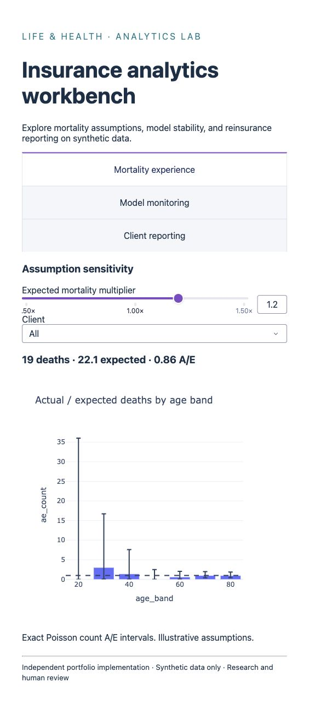
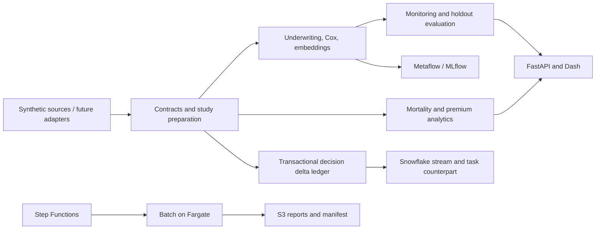

# Insurance Analytics Platform

An independent, runnable implementation of the life and health insurance analytics projects described in a supplied professional profile. It covers the path from study ingestion and underwriting models to mortality analysis, monitoring, reporting, and cloud execution.

**All examples use generated, fictional data and illustrative assumptions.** This repository contains no employer code, client records, proprietary mortality tables, or claims of reproducing an employer’s systems or business results. Models are research demonstrations for human review, not validated insurance decision systems.

## Quick start

Python 3.11–3.13; Python 3.13 is used for the reproducibility snapshot. On macOS, XGBoost also requires `brew install libomp`. Keep virtual environments outside cloud-synced folders if local storage optimization evicts installed library files.

```bash
python3 -m venv .venv
source .venv/bin/activate
pip install '.[dev]'
insurance-analytics demo
insurance-analytics dashboard
```

Open the dashboard at http://127.0.0.1:8050. The complete demo writes `artifacts/demo/report.html`, CSV studies, predictions, model metrics, an audit ledger, and a SHA-256 manifest. The HTML report is self-contained and works offline. Re-running a completed demo reuses the decision ledger: `new_decision_deltas` is zero on replay.

```bash
insurance-analytics api
# Interactive API reference: http://127.0.0.1:8000/docs
python -m pytest -q
ruff check src tests workflows
ruff format --check src tests workflows
```

For the tested core dependency snapshot, install `requirements.lock` first, then `pip install --no-deps .`. Optional workflow dependencies have their own `requirements-ml.lock`. Ordinary installation resolves the supported ranges in `pyproject.toml`. Run commands from the repository root. If using an editable install during development, use `pip install -e '.[dev]'`.



## Projects implemented

| Resume project | Implementation | How to exercise it |
|---|---|---|
| Impairment detection from questionnaires, labs, and Rx | Fold-local imputation/encoding; logistic or XGBoost classifier; sigmoid calibration; untouched temporal holdout | `underwriting.py`; `insurance-analytics demo --backend xgboost` after `pip install '.[ml]'` |
| Mortality slippage and benchmarking | Count/amount A/E, exact Poisson count intervals, versioned assumption adjustments, annual improvement, term death-benefit APV | `mortality.py`; dashboard Mortality tab; Snowflake views |
| Underwriting process-change pipeline | Durable event replay protection, version checks, field deltas and atomic snapshots; stream/task warehouse implementation | `deltas.py`; `sql/snowflake/001–002` |
| Model monitoring | Reference-fixed PSI, KS/FDR tests, missingness alerts, delayed-label performance, optional Evidently HTML and Metaflow job | `monitoring.py`; dashboard Monitoring tab; `workflows/monitoring_flow.py` |
| Serverless execution | Step Functions → AWS Batch → Fargate; private networking, bounded compute, S3 artifacts, IAM and logs | `infra/`; `cloud.py` |
| Docker and modular ECS infrastructure | Non-root image; local API/Dash services; reusable Terraform runtime including private ECS dashboard service | `Dockerfile`; `compose.yaml`; `infra/modules/runtime/` |
| RFP experience-analysis preparation | Study-window clipping, ACT/365.25 exposure, death handling, rejected-row quarantine and input fingerprint | `etl.py:prepare_study`; demo accepted/rejected CSVs |
| Reinsurance premium and volume reporting | Decimal half-up rounding, integer cents, currency segregation, transaction uniqueness, monthly policy snapshot volume | `reporting.py`; FastAPI `/v1/premiums`; dashboard Reporting tab |
| Survival mortality models | Cox partial likelihood, right censoring, Breslow ties, baseline survival, held-out concordance | `survival.py`; demo summary |
| Accelerated underwriting models | Separate full-review target; calibrated referral-risk probabilities; candidate coverage and missed-review diagnostics on holdout | `underwriting.py:acceleration_policy`; demo summary |
| CART A/E differential detector | Expected-death-weighted discovery tree; fixed-leaf holdout confirmation, exact intervals, credibility and FDR | `differentials.py`; demo differential CSV |
| Mortality entity embeddings | Learned categorical embeddings → tanh network → Poisson mean with expected-deaths offset; unknown-category fallback | `embeddings.py`; demo embedding holdout CSV |
| Cause-of-death process cleanup | Explicit ICD chapter groups, preserved unknown bucket, count validation and small-cell suppression | `etl.py:cause_of_death_summary`; demo cause CSV |

Leadership and product ownership responsibilities are reflected in the architecture, validation criteria, and operating runbooks; they are not represented as invented historical accomplishments. Detailed methods and limits are in [docs/methodology.md](docs/methodology.md).

## Architecture



The shared package keeps formulas and validation identical across batch and interactive consumers. The API deliberately uses a cached, explicitly named synthetic model; it does not deserialize arbitrary model files. Metaflow’s serialized artifacts and MLflow model artifacts must only be read from trusted stores with matching package versions.

## Optional integrations

```bash
pip install '.[ml]'
python workflows/underwriting_flow.py run --backend logistic
python workflows/monitoring_flow.py run
# Inspect local experiment tracking:
mlflow ui --backend-store-uri sqlite:///mlflow.db --host 127.0.0.1
```

Set `MLFLOW_TRACKING_URI` for a managed tracking service. Metaflow runs locally by default; the standalone AWS runtime executes the shared demo package. Exporting the Metaflow graph to AWS is a separate account-specific deployment, not implied by the Terraform module.

```bash
docker compose up --build
```

Cloud resources are **not deployed automatically**. See [docs/operations.md](docs/operations.md) for AWS prerequisites, Snowflake setup, costs, retries, rollback, and an explicit validation checklist. The private ECS dashboard is scaled to zero by default and has no inbound network rule; an authenticated ingress design must be added before remote access.

## Validation and provenance

[docs/validation.md](docs/validation.md) records checks actually performed and integrations that remain unverified. Tests cover actuarial hand calculations, signal recovery, holdout isolation, event replay/rollback, currency rounding, delayed labels, missing data, API validation and dashboard callbacks. CI runs the test suite, both model backends, demo artifact generation and Terraform validation. Cloud execution and Snowflake semantics need live account integration tests before operational use.

See [docs/project-map.md](docs/project-map.md) for acceptance criteria and [docs/architecture.md](docs/architecture.md) for extension points. Licensed under MIT.

## Engineering references

- [scikit-learn pipelines and leakage prevention](https://scikit-learn.org/stable/common_pitfalls.html)
- [scikit-learn persistence and environment compatibility](https://scikit-learn.org/stable/model_persistence.html)
- [Snowflake streams and transaction offsets](https://docs.snowflake.com/en/user-guide/streams-intro)
- [Terraform provider configuration](https://developer.hashicorp.com/terraform/language/providers/configuration)
